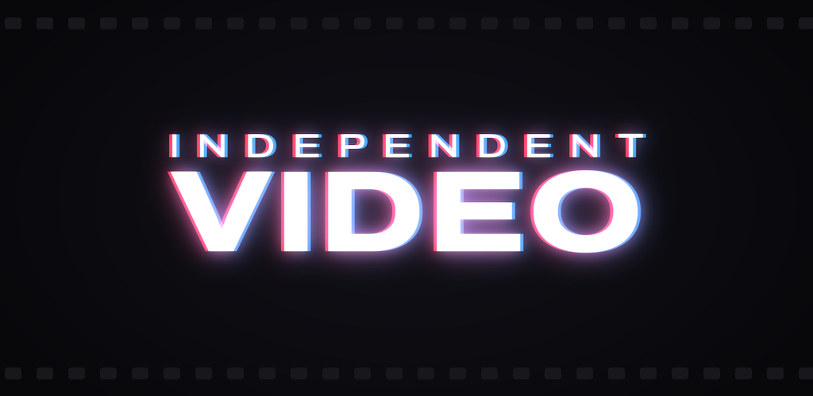

  

  <b>A video editor and a layered photo editor for Android.</b> 
  No account. No uploads. No ads. Everything stays on your phone.

  
  
  
  
  

---

## 🎬 Looking for 12 beta testers

Independent Video is in closed testing on Google Play. Google needs **12 people to keep it installed for 14 days** before it can go public. It takes about two minutes to join:

1. **Join the tester group:** [groups.google.com/g/independent-video](https://groups.google.com/g/independent-video). Use the Google account that's on your phone.
2. **Opt in to the test:** [play.google.com/apps/testing/com.betterappmafia.independentvideo](https://play.google.com/apps/testing/com.betterappmafia.independentvideo)
3. **Install it from Google Play:** [Independent Video on Google Play](https://play.google.com/store/apps/details?id=com.betterappmafia.independentvideo)

Then keep it installed for 14 days and use it whenever you like. Found a bug, or want a feature? Email **[cporter31415@gmail.com](mailto:cporter31415@gmail.com)** or open an [issue](../../issues). If the app ever closes unexpectedly, it shows a crash report the next time it opens. Copy that into the email.

> Opt-in not working yet? Join the group first and wait a few minutes. Google can take a little while to add new members to the test.

---

## What it does

### Video
Cut, color, retime and title your footage. Add music, captions and sound.

| | |
|---|---|
| **Timeline** | Multi-track, frame-accurate trims, split, roll and slip, B-roll and picture-in-picture |
| **Speed** | 0.1× to 10×, or speed curves you shape point by point. Keep the pitch or let it follow like tape |
| **Color** | Grading in layers: curves, levels, HSL, LUTs and 12 built-in looks, per clip or for the whole video |
| **Titles** | Titles and captions, with SRT subtitle import and export |
| **Music** | Beat detection, cuts that snap to the beat, and visualizers that follow the song |
| **Audio** | A 6-band EQ on every track plus a master EQ, volume keyframes, fades and ducking |
| **Viewer** | Drag the preview bigger, hide the toolbars, or turn your phone sideways for full screen |
| **Export** | 720p, 1080p or 4K at 24–60 fps, straight to your gallery |

### Photo
Layers, masks, curves and effects. Heal, remove and edit RAW photos.

| | |
|---|---|
| **Layers** | Photo, text, fill and adjustment layers with blend modes, groups and clipping |
| **Masks** | Brush, gradients, shapes, text and color ranges, and they stay editable |
| **Selections** | Lasso, polygon, magic wand, refine edge |
| **Retouch** | Heal, clone and content-aware remove |
| **Files** | Opens JPEG, PNG, WebP, HEIF and RAW (DNG); exports full-resolution JPEG or PNG |

---

## Your work stays yours

The app has **no internet permission**, so it can't upload anything. It has no account, no analytics, no ads and no tracking. Projects autosave, deleted projects go to a Trash you can restore from, and named versions let you step back to an earlier edit.

[Privacy policy](https://thenightmancometh-flac.github.io/independent-video/privacy/) · [Website](https://thenightmancometh-flac.github.io/independent-video/)

---

## Support

Independent Video is free. If it's useful to you, you can tip on **[Ko-fi](https://ko-fi.com/betterappmafia)**.

  
  &nbsp;Made by <b>Better App Mafia</b>. 
  &nbsp;This repository holds the project's website and info. The app's source code isn't published here.

